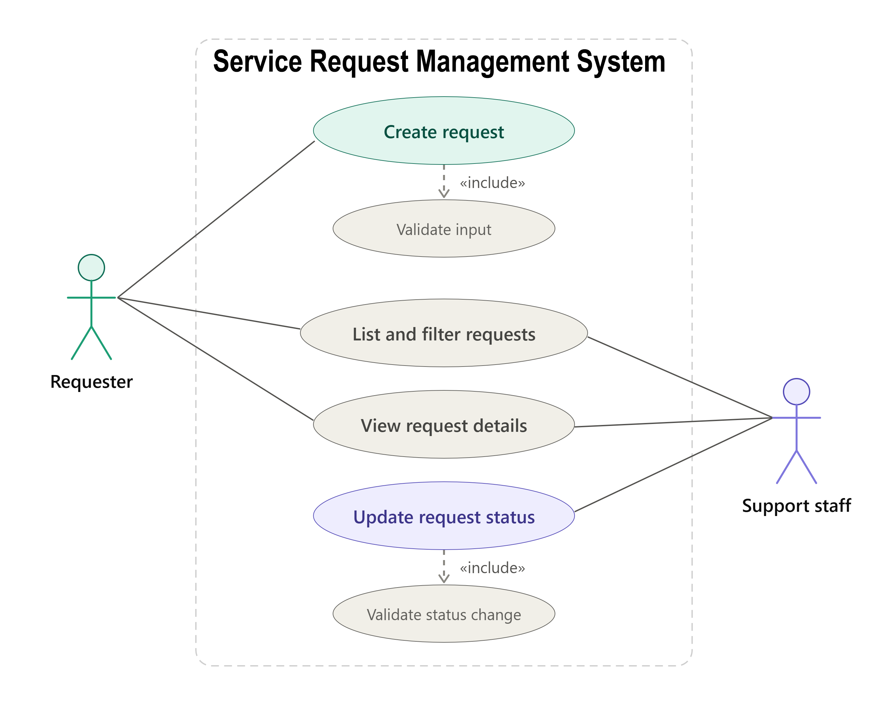
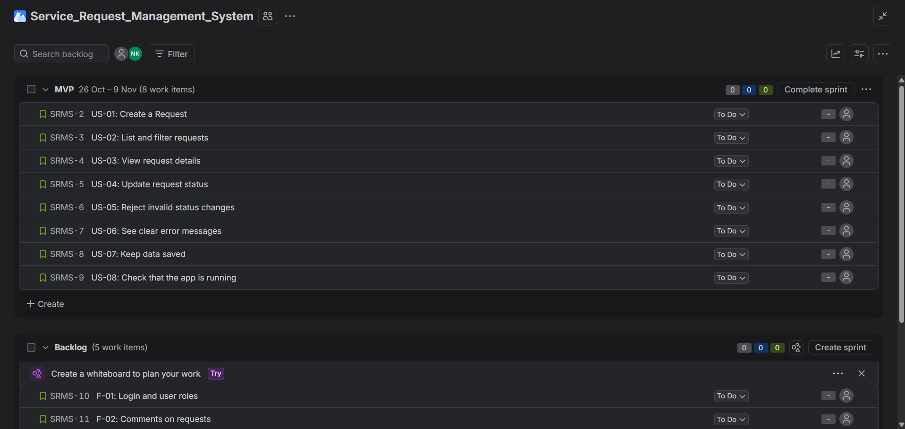
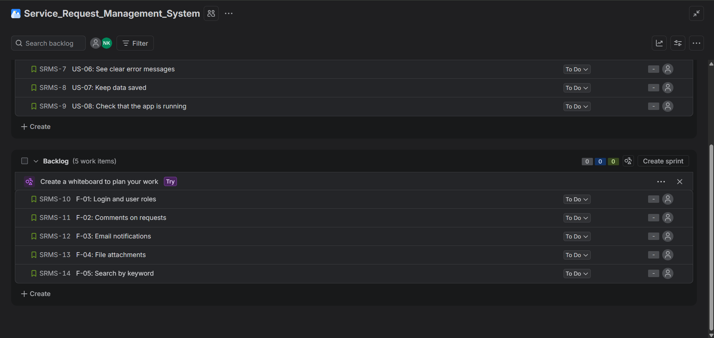

# Service Request Management System: Requirements

Nadeera Shasika
Day: 01 (Requirements and SDLC)

## 1. Problem Statement

In many organizations, when something goes wrong, such as a technical issue, billing problem, or account issue, it is difficult to know what happened and how it was solved. People inform the support staff about these problems, but they are not always sure who is handling them. The person who reported the issue also has to keep asking for updates.

I am building a simple web system where users can submit service requests and check their current status. Support staff can view the requests, handle the issues, update their status, and mark them as resolved or closed. This helps users track their requests easily and allows support staff to manage and solve issues more efficiently.

## 2. Users

### Requester
Any staff member who has a problem and needs help.
- Wants to report the problem quickly and in a clear way.
- Wants to check the status without calling or messaging anyone.

### Support staff
The person who looks after IT or facility problems.
- Wants to see all requests in one list.
- Wants to filter requests by status, so they know what needs work.
- Wants to update the status as work moves forward.

Note: Login and roles are not in the MVP. For now, anyone using the app can do both jobs.
### Use case diagram

## 3. Scope

In scope (MVP): create, list, view, update status, validation, error handling, health check, saving data in a database.

Out of scope (future): login and roles, comments, notifications, file upload, search.

## 4. Functional Requirements

- FR-1: The user can create a request with title, description, category and priority.
- FR-2: The user can see a list of requests and filter it by status.
- FR-3: The user can open one request and see its details.
- FR-4: The user can change the status of a request.
- FR-5: The system rejects invalid status changes.
- FR-6: The system validates input and returns clear errors.
- FR-7: The system saves all requests in a database.
- FR-8: The system has a health check endpoint.

## 5. Non-Functional Requirements

- NFR-1 Security: All validation happens on the server. No secrets (passwords, .env) are committed to Git.
- NFR-2 Reliability: Data is still there after the app restarts.
- NFR-3 Usability: The UI shows loading, empty, success and error states.
- NFR-4 Maintainability: Code is split into layers (controller, service, repository). README explains how to run the project.
- NFR-5 Testability: Important business rules (status changes, validation) have automated tests.

## 6. Data Rules

- title: required, text, 3 to 100 characters
- description: required, text, up to 1000 characters
- category: Technical,Billing,Account or Other
- priority: LOW, MEDIUM or HIGH
- status: OPEN, IN_PROGRESS, RESOLVED or CLOSED (new requests start as OPEN)

Allowed status flow:

OPEN -> IN_PROGRESS -> RESOLVED -> CLOSED

## 7. User Stories and Acceptance Criteria

### US-01: Create a request
As a requester, I want to create a service request with title, description, category and priority, so that support staff can see my problem.

Acceptance criteria:
- Given valid data, when I submit, then the request is saved with status OPEN and the API returns 201.
- Given an empty title, when I submit, then the API returns 400 with a clear message.
- Given a priority that is not LOW, MEDIUM or HIGH, when I submit, then the request is rejected with 400.

### US-02: List and filter requests
As support staff, I want to see all requests and filter by status, so that I can focus on what needs work.

Acceptance criteria:
- Given saved requests, when I open the list, then all requests are shown.
- Given I choose a status filter, then only requests with that status are shown.
- Given there are no requests, then the UI shows an empty state message.

### US-03: View request details
As a user, I want to open one request, so that I can read all its details.

Acceptance criteria:
- Given a valid request id, then the full details are shown.
- Given an id that does not exist, then the API returns 404 and the UI shows a "not found" message.

### US-04: Update request status
As support staff, I want to change the status of a request, so that everyone can see progress.

Acceptance criteria:
- Given a request in OPEN, when I set IN_PROGRESS, then the status is updated (200).
- Given the update is saved, when I reload the page, then the new status is still there.

### US-05: Reject invalid status changes
As the system owner, I want invalid status changes to be blocked, so that the workflow stays correct.

Acceptance criteria:
- Given a request in OPEN, when I try to set CLOSED directly, then the API rejects it with 400.
- Given a request in CLOSED, when I try to change it, then the API rejects it.

### US-06: Clear errors
As a user, I want clear error messages, so that I know what went wrong and how to fix it.

Acceptance criteria:
- Given invalid input, then the response has a consistent error format (status code and message).
- Given the server is not reachable, then the UI shows an error and does not show a fake success.

### US-07: Health check
As a developer, I want a health endpoint, so that I can check the app is running.

Acceptance criteria:
- Given the app and database are running, when I call GET /api/health, then it returns 200.

## 8. Backlog

The backlog is kept in Jira (project: Service_Request_Management_System, key SRMS). The MVP items are in the "MVP" sprint. The future improvements stay in the Backlog.

| Jira key | ID | Item | Type |
|---|---|---|---|
| SRMS-2 | US-01 | Create a request | MVP |
| SRMS-3 | US-02 | List and filter requests | MVP |
| SRMS-4 | US-03 | View request details | MVP |
| SRMS-5 | US-04 | Update request status | MVP |
| SRMS-6 | US-05 | Reject invalid status changes | MVP |
| SRMS-7 | US-06 | See clear error messages | MVP |
| SRMS-8 | US-07 | Keep data saved | MVP |
| SRMS-9 | US-08 | Check that the app is running | MVP |
| SRMS-15 | T-01 | Write setup documentation (README) | MVP |
| SRMS-10 | F-01 | Login and user roles | Future |
| SRMS-11 | F-02 | Comments on requests | Future |
| SRMS-12 | F-03 | Email notifications | Future |
| SRMS-13 | F-04 | File attachments | Future |
| SRMS-14 | F-05 | Search by keyword | Future |

Screenshots of the Jira backlog:

## 9. Definition of Done

A story is done when:
- The code works and is pushed to GitHub on a feature branch.
- Server-side validation is in place.
- Important rules have automated tests and the tests pass.
- README or docs are updated.
- No secrets are in the repository.

## 10. How each requirement will be verified

| Requirement | Story | How it is verified |
|---|---|---|
| FR-1, FR-6 | US-01, US-06 | API tests for valid and invalid create, plus UI screenshot of validation error |
| FR-2 | US-02 | API test for filter, plus UI screenshot of list and empty state |
| FR-3 | US-03 | API test for found and 404, plus UI check |
| FR-4, FR-5 | US-04, US-05 | Unit tests for status rules, plus API tests |
| FR-7, NFR-2 | US-07 | Restart the app and confirm data is still there |
| FR-8 | US-08 | Call GET /api/health and check for 200 |
| FR-9 | T-01 | Another person follows the README and runs the project |
| NFR-1 | US-01, US-06 | Check Git history and .gitignore for secrets, test server validation |
| NFR-3 | US-02, US-06 | UI screenshots of loading, empty, success and error states |
| NFR-4, NFR-5 | all | Code review of folder structure, test run output saved as evidence |